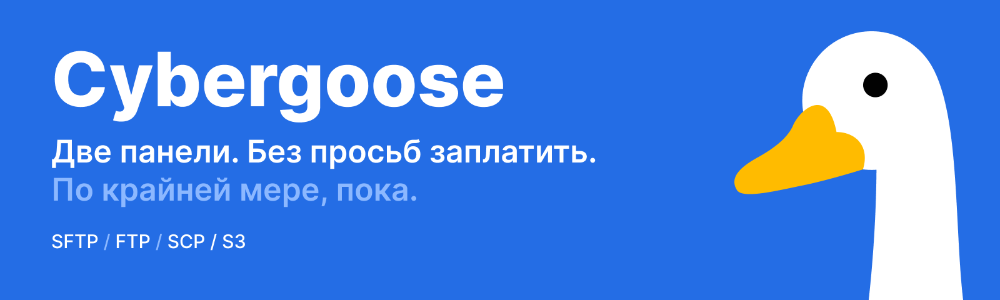
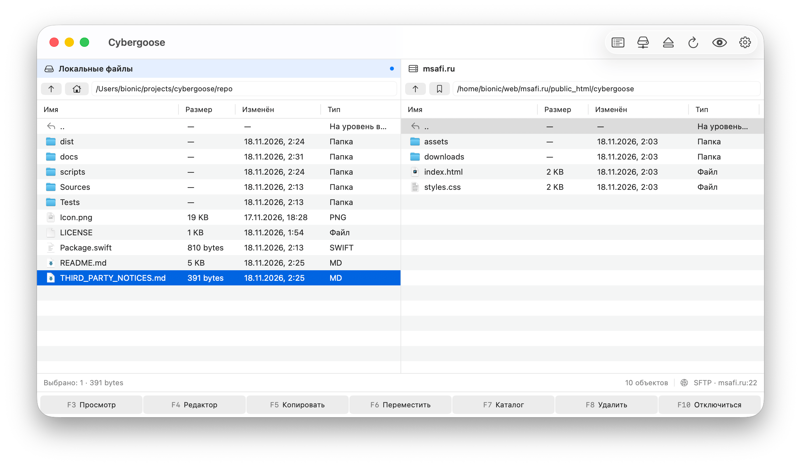

<p align="center">
  
</p>

# Cybergoose

**Нативный двухпанельный файловый клиент для macOS.**

Вдохновлён Norton Commander. Создан как бесплатная альтернатива Cyberduck,
которая не просит денег.

[Скачать для Mac](https://github.com/bionictlt/cybergoose/releases/latest/download/Cybergoose.dmg) · [Сборка](#сборка-из-исходников) · [Документация](docs/DEVELOPMENT.md) · [MIT](LICENSE)

<p align="center">
  
</p>

## Две панели — всё под рукой

Локальные файлы слева, сервер справа. Выделите нужные файлы и папки,
перетащите в другую панель — Cybergoose поставит копирование в очередь.
Или работайте с клавиатуры, как в привычном файловом командере.

- **SFTP, FTP/FTPS, SCP и S3-совместимые хранилища.**
- **Очередь операций:** копирование и перемещение, прогресс, отмена и повтор.
- **Конфликты имён:** заменить, заменить все, пропустить или отменить.
- **Quick Look и удалённое редактирование:** откройте файл в текстовом редакторе,
  сохраните — изменения отправятся на сервер.
- **Управление с клавиатуры:** Tab, F-клавиши, сочетания Finder и переход `..`.
- **Keychain и проверка SSH host key:** сохранение секретов по желанию.

Интерфейс написан на SwiftUI и AppKit. Для SSH используется libssh2,
для FTP/FTPS и S3 — системная libcurl.

## Скачать

Готовая сборка: **Apple silicon, macOS 26 или новее**.

Откройте DMG и перетащите Cybergoose в «Программы».

Проект находится на стадии **early preview**. Возможности и ограничения
пока меняются; сквозные сетевые проверки проведены не для всех протоколов.
Текущая сборка имеет локальную ad-hoc подпись и пока не нотарифицирована Apple.

## Клавиатура

| Клавиши | Действие |
|---|---|
| Tab | Другая панель и первый пункт списка |
| ⌘↓ / двойной клик | Открыть файл или каталог |
| ⌘↑ / `..` | Подняться на уровень выше |
| Enter | Переименовать; на `..` — перейти вверх |
| Пробел / F3 | Предпросмотр |
| F4 | Текстовый редактор |
| F5 / F6 | Копировать / переместить |
| F7 | Создать папку |
| F8 | Удалить с сервера |
| ⌘R | Обновить панель |

## Сборка из исходников

Нужны Swift 6, Xcode Command Line Tools, libssh2 и OpenSSL 3.

```sh
brew install libssh2 openssl@3
./scripts/build-app.sh
open dist/Cybergoose.app
```

Swift-код рассчитан на macOS 14. Минимальная версия готового приложения
зависит от сборок вложенных библиотек; текущая сборка требует macOS 26.

## Известные ограничения

- SCP передаёт содержимое файлов, а для просмотра каталогов и файловых команд
  нужен SFTP на том же SSH-сервере.
- Загрузка и переименование объектов S3 ограничены 5 GiB; multipart upload
  и переименование каталогов-префиксов пока не поддерживаются.
- Очередь передач и сеансы редактора пока не восстанавливаются после перезапуска.
- Автоматическая проверка обновлений и автообновление запланированы.

## Что дальше

- Проверка новых версий и автоматическое обновление.
- Проверки на разных SFTP/FTP/S3-серверах.
- Расширение совместимости готовых сборок с версиями macOS.

## Участие в проекте

Багрепорты, идеи и pull request приветствуются.
В сообщении об ошибке укажите версию macOS, версию Cybergoose, протокол
и шаги воспроизведения.

## Лицензия

[MIT](LICENSE) · © 2026 Marat Safi.

Лицензии сторонних компонентов: [libssh2](docs/licenses/libssh2.txt) и [OpenSSL](docs/licenses/OpenSSL.txt).
